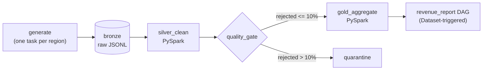

# Orders Pipeline: Airflow + PySpark

A self-contained data pipeline that ingests synthetic e-commerce orders, cleans them with PySpark,
validates them, and publishes daily revenue tables. No cloud account or secrets needed.
The data is deliberately messy so the pipeline has real problems to solve.



## What it demonstrates

| Feature | Where |
|---|---|
| Dynamic task mapping (parallel ingestion per region) | `dags/orders_pipeline.py` |
| Medallion layers: bronze, silver, gold | `src/silver.py`, `src/gold.py` |
| Idempotent writes (dynamic partition overwrite, seeded generator) | `src/silver.py`, `src/generator.py` |
| Explicit schemas and schema-drift handling | `src/silver.py` (`amount` vs `total_amount`) |
| Branching quality gate and quarantine | `quality_gate` task, `src/quality.py` |
| Dataset-aware scheduling (no cron guessing) | `dags/revenue_report.py` |
| Late-arriving data revises earlier days | `src/gold.py` recomputes from all silver |
| Backfill (`catchup=True`, `max_active_runs=1`) | DAG config |
| Window functions (7-row rolling average) | `src/gold.py` |
| Unit tests and CI | `tests/`, `.github/workflows/ci.yml` |

## The messy data

`src/generator.py` is seeded by (date, region), so reruns are reproducible. It injects duplicates,
null order IDs, negative amounts, late-arriving orders, a column rename (Mombasa on days divisible
by 10) and an incident (Eldoret sends ~35% corrupt rows on days divisible by 9).
Expect the run for the 9th to be quarantined, because its rejection rate is above the 10% threshold.

## Run it

Requires Docker Desktop.

```powershell
docker compose build
docker compose up airflow-init
docker compose up -d
```

Open http://localhost:8080 (user `admin`, password `admin`), unpause `orders_pipeline` and
`revenue_report`. Airflow will backfill from 2026-10-05, one day at a time.

Results appear under `data/`:

```
data/bronze/dt=2026-10-05/nairobi.jsonl     raw input
data/silver/orders/ingest_date=.../         cleaned Parquet
data/rejected/dt=.../                       rows that failed validation
data/quarantine/ingest_date=.../            a bad day pulled out of silver
data/gold/daily_revenue/                    final aggregates
data/reports/latest.md                      written by the revenue_report DAG
```

Run the tests locally with `pip install -r requirements-dev.txt` then `pytest`.

## Design notes

- **Why Parquet, partitioned by `ingest_date`?** Columnar storage suits aggregations, and partitioning by
  ingestion date means a rerun replaces exactly one partition. Partitioning by order date would let
  late rows overwrite a previous day's data.
- **Why recompute gold from silver each run?** Late orders land in an earlier `order_date`, so a
  full rebuild keeps history correct. At larger scale I would switch to incremental merges (Delta or Iceberg).
- **Why quarantine instead of failing the DAG?** One bad source should not block the pipeline, but its
  data must not reach gold. Rejected rows are kept with a reason for investigation.
- **Why a rolling window over rows, not calendar days?** Simple and fine for this data. A production
  version would fill missing dates first.

## Troubleshooting

- Spark write errors on Windows bind mounts: change `./data:/opt/airflow/data` in `docker-compose.yml`
  to a named volume.
- Permission errors on Linux: `mkdir -p data && chmod -R 777 data`.

## Possible extensions

- S3 sink (`boto3` upload after bronze) behind an environment flag
- Microsoft Graph API as a second source with the same bronze layout
- Delta Lake or Iceberg tables, and dbt models on top of gold
